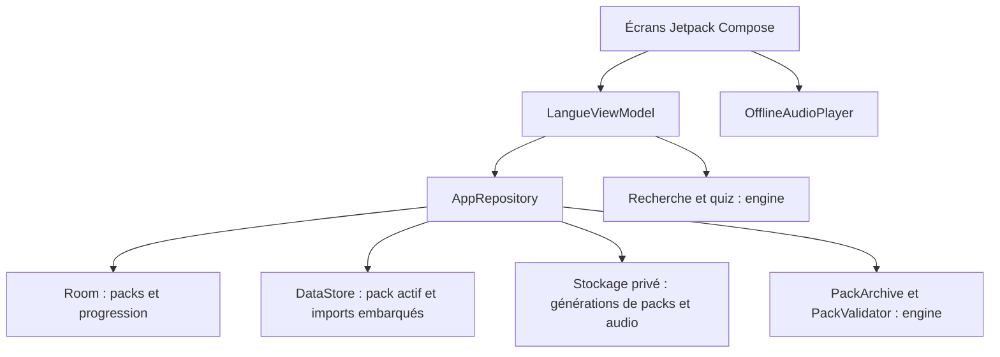

# Architecture

## Frontières

Deux modules Gradle séparent Android des règles métier. `engine` est un module Kotlin/JVM sans API Android ; `app` fournit Compose, le cycle de vie, le stockage et la lecture multimédia. Cette séparation permet de tester le format et le quiz sans appareil.

Les écrans observent des états ; les opérations suspendues de persistance et d’import s’exécutent hors du thread principal. Les textes d’interface sont dans les ressources Android. Le nom, le sous-titre, la présentation et l’accent sont fournis par la variante Gradle.

## Contenu et langues

`LanguagePack` associe un manifeste, des catégories et des éléments. Aucun vocabulaire, catalogue de langues ou liste de questions n’est inclus dans le moteur. Les codes, noms et directions des langues appartiennent aux données. Le pack actif définit la paire d’apprentissage ; cette sélection ne modifie pas la langue française de l’interface.

`VocabularySearch` compare les champs normalisés et retourne les objets originaux. `QuizEngine` produit une représentation de question indépendante de l’interface et du stockage. Un nouveau type d’exercice peut utiliser les mêmes packs et un nouveau générateur, sans restructurer l’import ni les écrans de vocabulaire.

## Installation des packs

1. Le sélecteur Android fournit un flux de lecture sans accès global au stockage.
2. `PackArchive` extrait dans un emplacement temporaire, contrôle les chemins et les limites, parse les JSON et valide les références.
3. Le repository vérifie les règles de mise à jour et écrit une génération de fichiers immuable.
4. Une transaction Room remplace le pack actif en base et conserve les consultations compatibles.
5. Les anciens fichiers sont retirés après la transaction. Les générations orphelines sont nettoyées au prochain démarrage.

Les mutations du repository sont sérialisées avec un `Mutex`. Un échec avant validation/transaction laisse le pack précédent utilisable. La base stocke le JSON validé du pack et la référence de sa génération ; les fichiers audio restent sur disque.

Les ZIP embarqués sont placés dans `assets/packs/` par la variante dédiée. DataStore mémorise ceux déjà importés : supprimer un pack depuis les paramètres ne le réinstalle pas automatiquement au lancement suivant.

## Progression

Room contient trois tables : packs installés, statistiques par pack et identifiants consultés par pack. La série courante et le record sont persistants, pas seulement mémorisés par l’écran. Une mauvaise réponse remet la série courante à zéro. Changer de pack affiche sa propre progression.

La suppression d’un pack efface sa progression. La réinitialisation porte sur le pack actif et conserve le contenu. L’export JSON concerne tous les packs installés et exclut leurs contenus. La restauration validée s’effectue en transaction ; voir [PROGRESS_FORMAT.md](PROGRESS_FORMAT.md).

DataStore contient les préférences de sélection et le suivi des packs initialement embarqués, pas les résultats de quiz.

## Audio et confidentialité

`OfflineAudioPlayer` encapsule `MediaPlayer` et la gestion du focus audio. Une nouvelle lecture arrête la précédente ; les erreurs, la fin de lecture et la libération rendent les ressources. Le code d’interface rattache cette instance au cycle de vie. Les fichiers sont résolus uniquement à l’intérieur de la génération installée du pack.

Aucun accès réseau, identifiant utilisateur, SDK publicitaire ou suivi n’est nécessaire. L’application n’a pas de permission Internet. Le stockage privé est supprimé à la désinstallation ; conserver un export personnel et les ZIP originaux avant de désinstaller ou de changer d’identifiant Android.

## Évolution

- Ajouter du contenu : modifier uniquement les fichiers du pack.
- Ajouter une identité d’application : propriétés de la variante dédiée et ressources d’icône.
- Traduire l’interface : ressources `values-<langue>/`, indépendantes des packs.
- Modifier Room : conserver les schémas exportés dans `app/schemas/`, augmenter sa version, fournir une migration et des tests ; ne pas utiliser de migration destructive pour masquer une incompatibilité.
- Faire évoluer le format des packs ou de sauvegarde : versionner le schéma et tester les anciens formats pris en charge.
- Tester les mécanismes purs dans `engine/src/test`, la persistance Android avec les tests de `app`, puis les interactions et le décodage sur appareil/émulateur.

Les données nécessaires aux tests restent dans les sources de test et ne doivent pas entrer dans les assets de production.

Le contrat générique `ExerciseGenerator<Q>` permet de créer d’autres exercices dans `engine`, avec leur propre représentation `Q`, sans dépendre de Room, des packs ZIP ni de Compose. Le quiz à trois choix est la première implémentation.

## Fiabilité des lectures et des exercices

`LangueViewModel` partage un état de bibliothèque dérivé de Room et DataStore. Une erreur de lecture produit un message français sécurisé et invalide la bibliothèque et le quiz ensemble ; l’action Réessayer resouscrit les lecteurs terminés. L’annulation des coroutines reste propagée.

Le pack actif est comparé et préparé sur `Dispatchers.Default`. `QuizEngine.prepare` produit un `PreparedQuiz` immuable, conservé uniquement pour ce pack. Un changement d’identifiant, de version ou de contenu remplace la préparation ; une mise à jour des statistiques ne la reconstruit pas. `PreparedQuiz.next` tire une question et deux groupes concurrents en temps constant, sans renormaliser ni parcourir les entrées. La question précédente est exclue lorsque possible.

Les écrans sont répartis dans `VocabularyScreen.kt`, `QuizScreen.kt`, `SettingsScreen.kt` et `EntryDetail.kt`. `LangueApp.kt` conserve navigation, sélecteurs de documents et cycle de vie ; `UiComponents.kt` et `LangueTheme.kt` regroupent les éléments visuels communs.

`FailureReason` et `FailureClassifier` séparent les causes techniques des textes de présentation. `UiErrorMapper` sélectionne les ressources de `errors.xml`. Les journaux `LangueErrors` contiennent uniquement opération/code/classe ; `LangueAudio` ajoute les étapes et codes numériques du décodeur. Les messages d’exception, traces, URI, identifiants et textes pédagogiques ne sont pas journalisés par ces composants.
